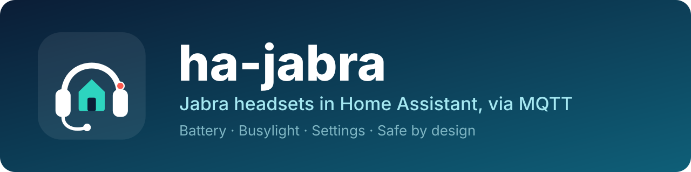
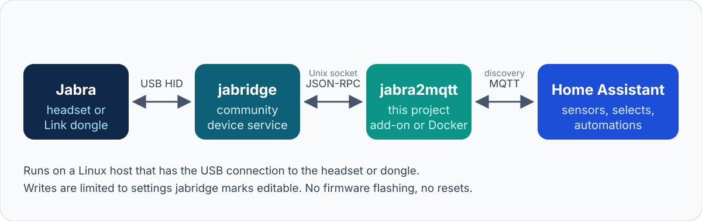

<p align="center">
  
</p>

<p align="center">
  
</p>

<p align="center">
  <a href="https://github.com/3DJupp/ha-jabra/actions/workflows/ci.yml"></a>
  
  
  
</p>

# ha-jabra

Bring a Jabra headset into Home Assistant: **battery**, **busylight**, **firmware version**,
**connection state** and the **settings** the headset allows to be changed (for example noise
control). Everything shows up as normal Home Assistant entities through MQTT discovery.

Target device: **Jabra Evolve2 85**. Other models work as far as
[jabridge](https://github.com/Watchdog0x/jabridge) supports them.

> **Status: alpha.** The bridge is covered by automated tests against a fake jabridge and a real
> (in-process) MQTT broker, but it has **not run against real Jabra hardware or a real Home
> Assistant OS yet**. Please read [docs/HARDWARE_TESTING.md](docs/HARDWARE_TESTING.md) and report
> what works.

## How it works



Jabra headsets are controlled over USB HID, not over Bluetooth LE, so the headset (or a Jabra Link
dongle) must be plugged into a Linux machine that runs the bridge. That machine can be your Home
Assistant host, a Raspberry Pi, a Proxmox LXC with USB passthrough or any other box.
[jabridge](https://github.com/Watchdog0x/jabridge) (a community re-implementation of Jabra Direct)
talks to the device; `jabra2mqtt` (this project) turns its state into MQTT discovery messages and
passes Home Assistant commands back.

## What you get

| Entity | Type | Notes |
| --- | --- | --- |
| Battery | sensor | percent, if the device reports a battery |
| Charging | binary sensor | |
| Battery low | binary sensor | diagnostic |
| Firmware | sensor | installed version, diagnostic |
| Connection | sensor | `usb` or via dongle, diagnostic |
| Busylight | select | `on` / `off` (and `auto` if you enable it) |
| Settings (noise control, HearThrough level, ...) | select | only settings jabridge marks editable and available |
| Read-only settings | sensor | disabled by default, diagnostic |

Entities appear under one Home Assistant device per Jabra device. They are marked unavailable when
the headset is unplugged or jabridge is not reachable.

## Install

### Option A: Home Assistant add-on

[](https://my.home-assistant.io/redirect/supervisor_add_addon_repository/?repository_url=https%3A%2F%2Fgithub.com%2F3DJupp%2Fha-jabra)

1. Add `https://github.com/3DJupp/ha-jabra` as an add-on repository.
2. Install **Jabra to MQTT**, plug the headset into the Home Assistant host, start the add-on.
3. Make sure the **Mosquitto broker** add-on (or another MQTT integration) is set up. The add-on
   picks the broker up from the Supervisor automatically.

The add-on needs full device access to reach `/dev/hidraw*`, which lowers its protection rating.
See [jabra2mqtt/DOCS.md](jabra2mqtt/DOCS.md) for the options.

### Option B: Docker next to any MQTT broker

```bash
cp docker-compose.example.yml docker-compose.yml   # edit broker, credentials and the hidraw device
docker compose up -d
```

Without Docker: install [jabridge](https://github.com/Watchdog0x/jabridge), start it
(`jabridge service start`), then `pip install .` and run `jabra2mqtt` with the environment variables
below.

## Configuration

Add-on options or environment variables (`JABRA2MQTT_<NAME>`, uppercase):

| Option | Default | Meaning |
| --- | --- | --- |
| `mqtt_host`, `mqtt_port`, `mqtt_username`, `mqtt_password`, `mqtt_tls` | add-on: from Supervisor | broker connection |
| `socket_path` | bundled jabridge | use an existing jabridge socket (`JABRIDGE_SOCKET`) |
| `allow_writes` | `true` | `false` = read-only mode, no entity can change the headset |
| `busylight_allow_auto` | `false` | offer busylight mode `auto` (needs PipeWire, see below) |
| `poll_interval` | `60` | seconds between battery and connection reads |
| `settings_interval` | `300` | seconds between settings reads |
| `base_topic` | `jabra2mqtt` | MQTT topic prefix |
| `discovery_prefix` | `homeassistant` | Home Assistant discovery prefix |
| `device_serial` | all devices | only manage this serial number |
| `log_level` | `INFO` | `DEBUG`, `INFO`, `WARNING`, `ERROR` |

## Example: busylight from an automation

```yaml
automation:
  - alias: Busylight on during calendar meetings
    triggers:
      - trigger: state
        entity_id: calendar.work
        to: "on"
    actions:
      - action: select.select_option
        target:
          entity_id: select.jabra_08c8c2253931_busylight   # jabra_<serial in lowercase>_busylight
        data:
          option: "on"
```

jabridge's own busylight `auto` mode follows call detection through PipeWire on a Linux desktop.
Inside the add-on there is no PipeWire, so drive the busylight from Home Assistant instead (a
calendar, a presence sensor, your phone's microphone state, ...).

## Safety by design

* **No firmware flashing and no factory resets.** The bridge never calls those methods, and a test
  fails if it ever does.
* Writes only for settings that jabridge marks editable and available, always with the device
  target and the previous value from the latest read, so a changed device or stale value is rejected.
* **No automatic retries of writes.** After an error or timeout the state is read again first.
* Retained MQTT command messages are ignored, so an old command can never replay after a restart.
* Read-only mode with `allow_writes: false`.

## Limitations

* Control needs a **USB connection** (cable or Jabra Link dongle) to the host. Plain Bluetooth LE
  control from Home Assistant is not possible with this approach.
* Several clients share jabridge's device selection. The bridge selects a device before reading or
  writing it, which can move the selection of an open jabridge menu.
* Renaming a device and setting a PIN are not implemented, because no protocol support was found.
* Firmware update status is not shown yet (see the roadmap).

## Roadmap

* Verify everything on a real Evolve2 85 and on Home Assistant OS, narrow the add-on's device access.
* Call and mute state as binary sensors, if the device reports them over jabridge.
* "Update available" sensor (read only). Installing firmware stays a deliberate manual step.
* Capture real device output as test fixtures.

More detail: [docs/PLAN.md](docs/PLAN.md), [docs/ARCHITECTURE.md](docs/ARCHITECTURE.md).

## Development

```bash
pip install -e ".[dev]"
ruff check . && ruff format --check . && mypy && pytest
```

## Credits and disclaimer

Built on [jabridge](https://github.com/Watchdog0x/jabridge) by Watchdog0x (Apache-2.0). This is an
independent community project, not affiliated with or endorsed by Jabra or GN Audio A/S. Jabra is a
trademark of GN Audio A/S; the Jabra logo in `assets/brand/` is used with permission and stays the
property of GN Audio. The ha-jabra banner and icon are original designs. Use at your own risk; changing device
settings can have effects you did not intend. See [THIRD_PARTY_NOTICES.md](THIRD_PARTY_NOTICES.md).

Licensed under the [Apache License 2.0](LICENSE).
